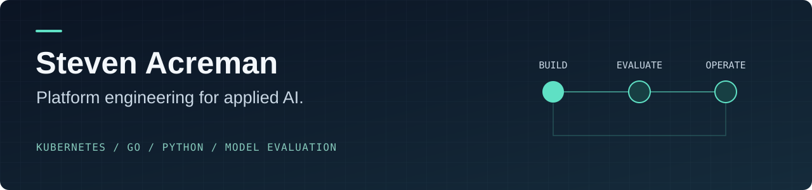

  <picture>
    <source media="(max-width: 600px)" srcset="https://raw.githubusercontent.com/sacreman/sacreman/main/assets/header-mobile.svg" />
    
  </picture>

  <a href="https://www.linkedin.com/in/stevenacreman/">LinkedIn</a> ·
  <a href="https://github.com/sacreman/thaipoai">Current project</a> ·
  <a href="https://github.com/Kubedex">Kubernetes tooling</a>

I build cloud infrastructure and developer tooling. I'm now applying that experience to self-hosted language models: training, evaluation and a path to dependable serving.

My background spans **Kubernetes, Terraform, Helm and observability**, with **Go and Python** for the tooling around them.

## Building now: ThaiPoAI

[**ThaiPoAI**](https://github.com/sacreman/thaipoai) is an experiment in self-hosted English–Thai translation: can a model we fine-tune replace a hosted translation service without losing meaning?

- **Implemented so far:** synthetic-data training feasibility experiments, documented findings, and an evaluation harness.
- **Next:** evaluate translation quality and context handling against a predefined go/no-go test.
- **Planned:** a reproducible training pipeline and controlled model rollout on Kubernetes.

The [feasibility report](https://github.com/sacreman/thaipoai/blob/main/docs/steps/01-feasibility.md) records what worked, what failed and the limits of the measurements. This is an ongoing experiment; production replacement has not yet been demonstrated.

## Selected open source

Earlier projects that show the platform engineering behind my current AI work:

| Project | Engineering focus |
| --- | --- |
| [**Helm Controller**](https://github.com/Kubedex/helm-controller) | Go controller for Kubernetes custom resources; manages chart installation, upgrades and removal through jobs. |
| [**Dolos**](https://github.com/Kubedex/dolos) | Python tooling to measure Kubernetes provisioning and teardown across cloud providers. |
| [**Terraform + Helmfile**](https://github.com/Kubedex/terraform-helmfile) | Connects infrastructure provisioning to repeatable chart deployment. |
| [**Chart Test Template**](https://github.com/Kubedex/chart-test-template) | A local K3s workflow for installing, linting and testing Helm charts. |

These are historical projects from 2018–2019, shared as examples of engineering work. Their dependencies and deployment instructions reflect that period.

## Contributions

Selected merged contributions to Akash Network:

- [Persistent storage support for the Akash node chart](https://github.com/akash-network/helm-charts/pull/24)
- [Rook/Ceph production configuration and end-to-end test fixes](https://github.com/akash-network/helm-charts/pull/64)

## Connect

Interested in AI/ML platforms, infrastructure or developer tooling? [Find me on LinkedIn](https://www.linkedin.com/in/stevenacreman/).
